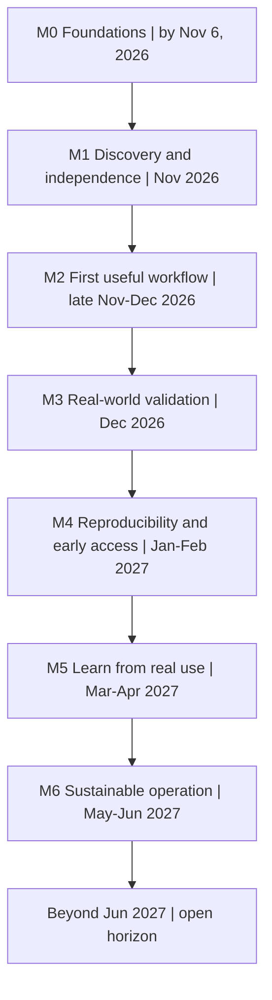

# CarpDraw — Project Map

Planning baseline: **October 29, 2026**. Last updated: **October 29, 2026**.

This is a living map: keep the current focus small, replace uncertainty with evidence, and revise dates when learning changes the work. [MEMORY.md](MEMORY.md) preserves the decisions, findings, and rationale behind this current view; [README.md](README.md#viewing-and-editing-the-plan) explains how to read and edit it.

## Current Focus

| | Now |
| --- | --- |
| Active milestone | **M0 — Foundations**, target November 6, 2026; in progress. |
| Primary outcome | A shared, evidence-labelled starting point that a new collaborator can understand without reconstructing private conversations. |
| Next concrete action | With the source integrated, prepare a controlled local reproduction proposal from the [intake findings](docs/source-intake-2026-10-29.md), and continue the founder walkthrough and account/deployment handover. Installs, external access and service startup remain separately authorized. |
| Main blocker | Source has arrived, but runtime reproduction, production configuration/access, ownership evidence and showcase observation remain missing. |
| Most important recent discovery | The source is a Laravel/Vue application with billing, private uploads and queued image generation. Static review found useful safeguards, unavailable 3D workflows, and generation/queue failure risks; runtime behavior remains unverified. |

## Vision

CarpDraw intends to make useful creative and technical work with digital models more accessible. The reported areas of interest are furniture, architectural components, parts, and fittings; other related objects may be explored. The precise product promise remains open.

**Founder’s own words:** _Awaiting her description of who she wants to help, what they should be able to do, and what creative independence means to her._

Utility before spectacle means evaluating outputs in a real task. Accessibility means considering cost and barriers early. Quality requires evidence; transparency should explain relevant limits and costs without disclosing private information. Creative direction stays with the founder. Engineering should be understandable, maintainable, and affordable, with room to change direction.

Still unresolved: the first audience, the problem worth solving, required output formats and quality, and the appropriate boundaries of the product.

## Current Reality

Use these labels throughout: **Verified** — direct evidence; **Reported** — communicated but not independently checked; **Hypothesis** — plausible and untested; **Proposed** — a suggested action or plan; **Unknown** — insufficient information. Attach a source and date when promoting a claim to Verified.

| Status | Current understanding | Basis / next evidence |
| --- | --- | --- |
| Verified | The initial local folder was empty and was not a Git repository. No product implementation was available to inspect. | Local directory inspection and Git status, October 29, 2026. |
| Verified | Local documentation, shared memory, and one explicit project-review skill exist; Git is initialized on `main`, with no remote. | File inspection and Git status/remote checks, October 29, 2026; see [memory](MEMORY.md). M0's shared review and showcase evidence remain outstanding. |
| Reported | The founder, an architect, developed an experimental showcase with AI-assisted tools and another developer's help. | Technical partner's bootstrap brief, October 29, 2026; walkthrough pending. |
| Reported | The previous developer configured an environment that may be complex; there is no established project-owned GitHub repository. | Same brief; account and dependency inventory pending. |
| Verified | The technical partner supplied a Git bundle on October 29. Its included history passes integrity checks: 71 commits across refs; main at `c0f2b8d`. It was inspected in isolation, then integrated at this repository root with its main ancestry and the existing governance history preserved. | [Source intake](docs/source-intake-2026-10-29.md); [CD-014](MEMORY.md#cd-014) and [CD-015](MEMORY.md#cd-015). Receipt/import does not verify ownership or account access. |
| Unknown | Showcase behavior, completeness, quality, reliability, and real user value. | Observe a real task and retain permitted evidence. A showcase is not a production-ready MVP. |
| Verified / Unknown | Static frontend/backend structure and configuration are inspected; running behavior, deployment environment, account ownership and actual costs remain Unknown. | [Source intake](docs/source-intake-2026-10-29.md) and [handover](docs/HANDOVER.md). Source documentation's production claims remain Reported. |

**Showcase record to complete:** access location or owner-held reference: Unknown; walkthrough date/observer: pending; intended task and input: Unknown; observed steps and output: Unknown; failure/recovery behavior: Unknown; manual assistance and repeatability: Unknown. Record only observed behavior as Verified; keep explanations of hidden implementation Reported or Unknown. Keep private access links and user data outside Git.

## Roadmap

These are **proposed planning windows** from the October 29 bootstrap brief, not fixed delivery commitments or estimates derived from a technical audit. M0 is active; M1–M6 are proposed. Reassess the sequence at each decision point. A calendar date alone never completes a milestone; record evidence here when it is met. The diagram shows the intended learning progression; the milestone text defines dependencies, and overlapping discovery can proceed where those dependencies allow.

### M0 — Foundations · target November 6, 2026

- **Objective / outcome:** Establish this workspace and a shared starting picture: knowns, unknowns, a showcase description, access process, space for the founder's vision, and proposed M1 scope.
- **Completion evidence:** The required documents exist; a permitted walkthrough or dated founder account describes the showcase with evidence labels; founder and partner review the map; a new collaborator can identify uncertainties and the next step without a private briefing. File creation alone is insufficient.
- **Dependencies / open questions:** Founder participation and an authorized source of showcase information. Who controls access, and what can be shared now?
- **Decision point:** Confirm the shared picture and choose M1's accessible scope. **Outstanding:** showcase evidence, founder's words, and human review.

### M1 — Discovery & Technical Independence · November 2026

- **Objective / outcome:** Understand the existing product and a first meaningful user problem. Pursue handover, inventory accessible frontend/backend dependencies, describe a user workflow, identify candidate users and alternatives, and investigate costs.
- **Completion evidence:** A dated workflow account, initial user/problem evidence, an alternatives comparison, an access-gap register with owners or explicitly unassigned owners, and a cost investigation stating measured items and unknowns. With source access, include an inventory; without it, include permitted black-box observations and a scoped independent discovery path. Do not claim technical independence has been achieved while critical dependencies remain inaccessible.
- **Dependencies / open questions:** Access to the founder and prospective users; source delivery is not the sole completion gate. Which dependencies block a useful experiment, and which merely delay an audit?
- **Decision point:** Select one M2 workflow and an evidence-backed path: retain, simplify, independently rebuild if justified, or continue discovery. No architecture decision is made here.

### M2 — First Useful Workflow · late November–December 2026

- **Objective / outcome:** Demonstrate one useful end-to-end task with explicit input/output requirements, quality criteria, failure cases, preliminary cost estimates, and technical blockers.
- **Completion evidence:** A reproducible run or independently verifiable showcase with permitted example inputs/outputs, assessment against the intended task, disclosed manual steps, failed attempts, and cost basis. Visual appeal alone does not establish engineering usability.
- **Dependencies / open questions:** A chosen problem and a permitted way to test it. What makes the output useful, and can another person verify that judgment?
- **Decision point:** Test the workflow with relevant people, narrow it, or revise the hypothesis.

### M3 — First Real-World Validation · December 2026

- **Objective / outcome:** Learn from prospective users' real tasks and guided testing where feasible.
- **Completion evidence:** Consent-appropriate, anonymized feedback with task examples, what worked or failed, and a recorded decision about the next direction. If hands-on testing is unavailable, label interview findings separately from observed usage.
- **Dependencies / open questions:** Relevant participants and a clear description of what can actually be tested. Does the workflow improve their current alternative?
- **Decision point:** Continue, reshape, or pause the workflow. No public launch is required; allow a lighter rhythm at the end of December.

### M4 — Reproducibility & Early Access · January–February 2027

- **Objective / outcome:** Subject to the audit, establish reproducible development, clear frontend/backend responsibilities, secure configuration, minimal checks, controlled deployment, and limited access with operating and spending limits.
- **Completion evidence:** Another authorized developer can build/test/run it; a controlled deployment and recovery path are demonstrated; access and spending controls are verified and have an owner.
- **Dependencies / open questions:** Adequate code/service rights, useful-workflow evidence, operating budget, and a technical audit or an authorized independent implementation audit. What is the smallest safe early-access scope?
- **Decision point:** Approve a bounded early-access trial or defer it until readiness gaps are closed.

### M5 — Learning from Real Use · March–April 2027

- **Objective / outcome:** Evaluate actual usefulness, repeated needs, model quality, workflow friction, and possible distribution channels; remove unnecessary complexity.
- **Completion evidence:** Consented usage/feedback and quality/cost observations lead to a short, justified set of improvements and a distribution experiment, where appropriate.
- **Dependencies / open questions:** Real usage and a supported, affordable trial. What brings people back, and what costs more than it helps?
- **Decision point:** Choose the next improvement or revise the product direction based on use.

### M6 — Sustainable Operation · May–June 2027

- **Objective / outcome:** Understand costs, funding, reliability, and responsible resource allocation.
- **Completion evidence:** Actual operating costs, a human-approved funding/usage policy, named operational responsibility, and a reasoned continue/change/pause decision.
- **Dependencies / open questions:** Cost and usefulness evidence, funding commitments, and available maintenance capacity. What service can the project sustain?
- **Decision point:** Agree the next stage; keep developments beyond June open rather than committing speculative features.

## Product and Audience

| Discovery area | Starting point | Next evidence |
| --- | --- | --- |
| Target audience | Unknown; no segment has been selected. | Founder proposes candidate people, then discusses an actual recent task with them. |
| Potential use cases | Hypothesis: AI assistance could help with some furniture, architectural-component, part, or fitting modelling tasks. No particular workflow is established. | Walk through one task from initial input to downstream use. |
| Real user problem | Unknown; AI generation alone is not a value proposition. | Record the current difficulty, frequency, effort, and consequences. |
| Current alternatives | Unknown; include existing tools, manual work, and choosing not to do the task. | Compare the same task and required result, not feature counts. |
| Required output quality | Unknown; formats, dimensions, editability, fidelity, and downstream suitability depend on the task. | Agree acceptance criteria with intended users; test representative successes and failures. |

Begin with a founder walkthrough and a small number of relevant conversations. Keep findings in this map until actual evidence volume justifies another file.

## Technical Readiness

Static source structure was inspected on October 29, 2026 at bundle main `c0f2b8d`; see the [source intake report](docs/source-intake-2026-10-29.md). This verifies code/configuration presence, not execution or production readiness. Runtime validation and operational ownership remain open. The [handover checklist](docs/HANDOVER.md) carries collection detail.

| Area | Status | Evidence needed |
| --- | --- | --- |
| Frontend | Verified source; runtime Unknown | Vue/TypeScript/Inertia workspace and Blade marketing. Build, browser behavior, accessibility and hosting need verification. |
| Backend | Verified source; runtime Unknown | Laravel 12 monolith, controllers/services, auth, billing, queues and migrations. Reproduce critical flows and failure boundaries. |
| AI inference and providers | Verified adapters; live behavior Unknown | Gemini/OpenAI/OpenRouter plus fake image providers. Real adapters accept raster inputs; configured 3D formats are rejected. Validate contracts, output quality, quotas, retention and cost. |
| Data and storage | Verified configuration; operations Unknown | SQLite local defaults; PostgreSQL/Redis container configuration; private project storage and optional R2. Verify deployed access, deletion races, backups and restores. |
| Infrastructure | Partially described; ownership Unknown | Docker and service configuration exist; production accounts, DNS, permissions, billing owners and external dependencies need handover. |
| Deployment | Incomplete handover | Inherited workflows are retained as inactive templates under `.github/workflows-disabled/`. They reference a self-hosted runner and an absent server-side deploy script; production Compose/Nginx are described as external. Configure new CI and verify deployment/rollback before enabling. |
| Security | Preliminary offline checks passed; assessment incomplete | No matching credential tokens or unsafe Git/archive paths detected. Review dependency advisories, credentials, access boundaries, asset rights and actual deployment. |
| Observability | Verified integration code; operation Unknown | Sentry/PostHog/error reporting code exists. Provider request/usage metadata is not persisted by the reviewed generation job; responder and live diagnostic access are unknown. |
| Testing | Suites present; not executed | PHP, Vitest, Playwright, concurrency, queue and backup checks supplied. No PHP/Composer on the inspected PATH; no dependencies installed. Runtime results and coverage remain unverified. |
| Operational costs | Unknown | Credit accounting exists, but repeated paid generation after storage failure is possible. Measure attempts, accepted results, retries, infrastructure and maintenance; establish a spend boundary. |

### Infrastructure evolution

Stages describe minimum capabilities, not a technology selection. The local Git workspace can exist immediately; a private documentation remote can precede reproducibility if ownership and publication permission are settled. Imported code and automated execution need their own readiness checks.

| Stage | Entry conditions | Minimum useful outcome | Risks to resolve | Explicitly defer |
| --- | --- | --- | --- | --- |
| 0 — Ownership & Access | Identify current custodians and permissible scope. | Rights and access expectations recorded; owners and missing access visible; legitimate project control pursued. | Third-party dependence, unclear rights, inaccessible accounts. | Unapproved transfers, credential rotation, provider replacement. |
| 1 — Reproducibility | Authorized source/configuration available for the component under examination. | Another developer can follow documented versions, configuration names, and build/test/run steps; inaccessible parts are stated. | Hidden manual setup, missing assets, accidental live writes or paid calls. | Rewrites, new frameworks, final repository topology. |
| 2 — Version Control & Collaboration | Shareable material, agreed repository owner/permissions, and explicit remote authorization. | Private GitHub repository with separate accounts, reviewable changes, shared documentation, and agreed contribution flow. | Secret/history disclosure, unclear permissions, lost source provenance. | Elaborate branch policies, issue taxonomy, extra management tools. |
| 3 — Delivery | Reproducible authorized components, known checks, deployment authority, and bounded environment/cost. | Minimum useful automated checks and controlled release/rollback path. | Configuration drift, privileged CI, unsafe data changes, duplicate paid jobs. | Extensive pipelines, orchestration platforms, microservice decomposition. |
| 4 — Operations | Controlled deployment, named responder, known data obligations, and approved spending limit before user access. | Useful logging/alerts, applicable backups and restore checks, bounded retries, access controls, and spending enforcement. | Unobserved failure, leaked data, retry storms, budget exhaustion, single-person dependence. | High-availability designs and extensive instrumentation without demonstrated need. |

## Sustainability

The aim is accessible, useful software under real resource constraints. Subscriptions, artificial feature restrictions, and revenue maximization are not default goals. No prices, budgets, funding commitments, or economic model have been selected.

The received source already contains Stripe Maker/Studio subscriptions, configured prices, credits and feature restrictions. That is a verified implementation fact, not adoption of those policies by the founder or technical partner. Reconcile the inherited product/economic assumptions with the agreed vision before enabling billing.

| Cost category | Include |
| --- | --- |
| Variable | AI inference, unsuccessful generations, retries/regeneration, variable storage/network use, and transaction fees where applicable. |
| Fixed and operational | Hosting, domains/services, monitoring, maintenance, support, development effort, security, and backups. Track cash expense and contributed time separately. |

Measure within a stated period and workflow; distinguish estimates from actual bills:

- **Marginal cost per generation:** Incremental attributable cost of one defined attempt, including its provider work and variable resources. Record whether automatic retries are part of that attempt to prevent double-counting.
- **Cost per useful accepted result:** Total attributable variable cost across successful and unsuccessful attempts divided by results meeting agreed acceptance criteria. With no accepted results, report no useful result and the cost incurred; do not report a zero unit cost.
- **Total operating cost:** Variable plus fixed/operational costs for the period. Report unpaid development/maintenance effort alongside cash costs rather than silently treating it as free.
- **Subsidized cost:** The portion borne by the project budget or patrons instead of users; record the funding source and limits.
- **User-facing price, if any:** A policy decision informed by costs, subsidies, transaction charges, and any applicable obligations; it is not automatically equal to marginal cost.

| Possible model | Practical condition | Unresolved trade-off |
| --- | --- | --- |
| Free access | A defined funded budget, bounded usage, and an enforceable spend ceiling. | Accessibility versus finite capacity and fair allocation. |
| At-cost usage | Transparent attribution of generation costs with an agreed failed-attempt and retry policy. | Users' predictability versus variable costs; treatment of shared overhead remains open. |
| Patron-supported access | Voluntary contributions or sponsorship with clear commitments and subsidy rules. | Funding uncertainty and obligations versus creative independence. |
| Hybrid | Explicit rules about who pays or receives subsidy and when. | More flexibility adds policy and support complexity; justify it before adopting it. |

**Questions to settle:** What monthly budget is available, and who is responsible for expenses? What counts as useful output? How much do failures cost? Which costs can reasonably be subsidized? Which financial information should users see? What obligations would external funding introduce?

**Before incurring spend or expanding access:** Agree a budget owner, provider limits, bounded retries, concurrency/usage limits where needed, and a response to budget exhaustion. Decide whether to pause new work, queue it, or seek explicit additional funding; do not assume spending can continue. Alerts alone do not enforce a spending ceiling. Implementation follows the audit.

## Collaboration and Working Rhythm

The founder leads vision, creative direction, user understanding, priorities, and day-to-day product evolution. The technical partner contributes technical leadership, architectural review, infrastructure/security guidance, planning support, and investment oversight within agreed financial constraints. Confirm the detailed approval boundaries together. Codex supports their decisions; it does not take ownership of them.

Use separate GitHub and Codex accounts with explicit permissions. PROJECT.md holds the current plan; [MEMORY.md](MEMORY.md) holds durable findings, decisions, evidence, and rationale; HANDOVER.md holds access and technical collection details. Read the plan and memory at the start of substantive work. Save accepted decisions, lasting constraints, material findings, and explicitly requested memories; skip routine answers and unaccepted daily suggestions. Keep proposals distinct from adopted decisions and preserve superseded reasoning. Personal chats do not replace the shared record; separate clones share updates only after the relevant commits are exchanged.

Repository records and commit messages are in English. Live conversation follows the user's current language until they switch; this does not change project scope, evidence status, or approval requirements. Batch substantive changes and associated memory in small, reviewed local commits, rather than committing every answer. A memory-only commit can wait when it would trigger a new sandbox approval; disclose the uncommitted state and preserve unrelated work. Prefer pull requests for meaningful work once GitHub is established. Introduce GitHub Issues when task volume warrants them. Do not introduce another project-management system.

Routine reversible work inside the repository needs no extra conversational approval within the user's task. Access outside the repo, internet use, changes to user/global settings, and sensitive or externally visible actions require scoped approval unless already explicitly authorized. Actual Codex sandbox restrictions still apply; AGENTS.md does not change them. The [local permission configuration](docs/codex-permissions.proposed.toml) remains an inactive proposal by the technical partner's choice. Keep current permissions; revisit activation only if the user requests it ([CD-013](MEMORY.md#cd-013)).

A proposed weekly review asks: What was created? What was learned? What did not work? What matters next? What is the smallest next step? Use `$project-review` deliberately when useful; no automation is scheduled. Update Current Focus with one outcome, an actionable next step, blockers, and a discovery. Assess progress by evidence and usefulness, not task or commit counts. Keep exploratory ideas without deadlines.

**Moving into GitHub, when authorized:** Agree the project-controlled owner, private visibility, and each person's permissions; review local commits and any imported history for rights, secrets, and intended author identity; create or select the approved private repository; add its verified remote and push only with explicit authorization. Preserve source provenance when code arrives, review imports before running them, and decide repository layout from the audit. Confirm both people can clone and contribute; agree a light pull-request review flow. Version-controlled code, documents, decisions, configuration, and delivery workflows should become the shared record without committing credentials or private data.

## Open Questions

1. Who owns the code, assets, service accounts, and redistribution/modification rights, and who can authorize access? **First step:** agree the [handover contact and access record](docs/HANDOVER.md#access-record).
2. What does the showcase actually do, and where does it rely on hidden services or manual assistance? **First step:** one permitted, dated task walkthrough.
3. Whose problem is worth solving first, and what makes the output usable? **First step:** founder's account plus a real task example and current alternative.
4. What can be sustained financially and operationally, by whom? **First step:** agree expense responsibility and a discovery spending boundary before paid experiments.
5. What should be preserved or changed technically? **First step:** audit accessible evidence; keep architecture and repository topology undecided until then.

The largest current risks are unclear ownership and access, undocumented dependencies, mistaking an attractive result for a usable model, uncontrolled generation costs, and support or operational knowledge concentrated in one person. Track concrete evidence as it appears rather than treating these risks as confirmed defects.

## Ideas for Later

No commitments or deadlines: other design/construction object categories; experiments in patron-supported access; workflow directions suggested by user evidence; founder sketches and unexpected discoveries. Add the idea, why it might matter, and what evidence would justify revisiting it. Do not promote an idea into scope without a human decision.

## Recent Decisions

| Date | Decision / status | Memory reference |
| --- | --- | --- |
| October 29, 2026 | The technical partner authorized root integration, preservation of both histories and all supplied refs locally, retention of governance, and inactive inherited workflows. GitHub publication remains a separate, unrequested action. | [CD-015](MEMORY.md#cd-015) |
| October 29, 2026 | Source bundle received and reviewed offline. Controlled local import is recommended; runtime, deployment and publication are not cleared. Milestone windows and strategic choices remain unchanged. | [CD-014](MEMORY.md#cd-014) |
| October 29, 2026 | Use executive summaries and senior operational manager judgment for management topics; principal software lead judgment for technical topics — authorized by the technical partner. | [CD-010](MEMORY.md#cd-010) |
| October 29, 2026 | Save durable shared memory selectively; batch local English commits with substantive work; require scoped approval for external access and sensitive actions. Keep the permission proposal inactive — authorized by the technical partner. | [CD-012](MEMORY.md#cd-012), [CD-013](MEMORY.md#cd-013); recording frequency supersedes [CD-006](MEMORY.md#cd-006) |
| October 29, 2026 | Accept multilingual prompts and match live replies; retain English repository records — authorized by the technical partner. | [CD-007](MEMORY.md#cd-007) |
| October 29, 2026 | Keep the workspace minimal, architecture undecided, and remote operations explicitly authorized — bootstrap constraints. | [CD-003](MEMORY.md#cd-003) |
| October 29, 2026 | Use one explicitly invoked review skill — authorized workflow with an invocation-policy implementation. | [CD-005](MEMORY.md#cd-005) |
| October 29, 2026 | M0–M6 windows, first workflow, and economic options remain Proposed. | [CD-004](MEMORY.md#cd-004) |

Keep this as a short index. Record full evidence, alternatives, rationale, decision authority, and revisit conditions in MEMORY.md, then update the affected current-state sections here. Do not maintain competing copies of the decision history.
